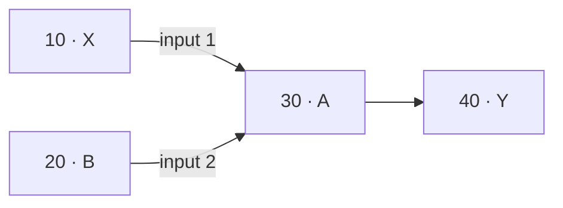

# Follow a pattern from graph to match

CorGIReg searches a graph of operations. A node ID identifies one operation.
An operation name or a library predicate tells the matcher which operations
can fill a position in a pattern. The arrows constrain how those operations
connect. A match records the source IDs and the walks that satisfied the
pattern.

## Match a shared input and an optional branch

Save this graph as `build/walkthrough.json` from the repository root.

```json
{
  "nodes": [
    {"id": 10, "op": "X", "name": "main input"},
    {"id": 20, "op": "B", "name": "optional input"},
    {"id": 30, "op": "A", "name": "join"},
    {"id": 40, "op": "Y", "name": "result"}
  ],
  "edges": [[10, 30], [20, 30], [30, 40]],
  "connections": [
    {"from": 10, "to": 30, "input": 1},
    {"from": 20, "to": 30, "input": 2}
  ]
}
```



Run the installed CLI. The single quotes work in PowerShell and POSIX shells.

```sh
corgireg -i build/walkthrough.json -r 'X-1->A#<-B?;A#->Y'
```

Read the pattern as three paths. The parser expands the convergence to
`X-1->A#;A#<-B?;A#->Y`. All occurrences of `A#` bind node 30. The first path
requires input 1 of node 30, the second may consume a `B` before the join,
and the third must reach `Y` after the join. The match with no `B` still
contains the join in the second walk.

| `node_ids` | Count for quantifier 1 (`?`) | Why the match succeeds |
| --- | ---: | --- |
| `[10, 30, 40]` | 0 | The ordinary anchor allows the unused input from node 20. |
| `[10, 20, 30, 40]` | 1 | The optional path captures node 20 and reaches the same join. |

Try the following changes independently.

| Change | Result |
| --- | --- |
| Use `X-1->$A<-B?;A#->Y`. | Only the four-node match survives. `$A` shares the identity of `A#` and requires every input neighbor to be captured. |
| Use `X-2->A#<-B?;A#->Y`. | No match. Node 10 reaches input 1, even though another producer reaches input 2. |
| Use `X-1->A<-B?;A#->Y`. | The parser reports an illegal convergence. The meeting point must be a common anchor. |
| Use `X-1->B?->A#;A#->Y`. | The parser reports an illegal numbered arrow. The adjacent `B?` can be skipped. |

`node_ids` is the sorted union of captured IDs. To recover traversal order,
read `walks[].nodes`. To understand why the same IDs can occur in more than one
match, read the quantifier counts and their capture ranges. See
[match reports](match-report-json.md) and [match traces](match-traces.md).

## Follow the compiler and the search

1. The lexer recognizes predicates, arrows and markers. The parser builds
   the abstract syntax tree (AST), expands the shared convergence, and
   validates each numbered arrow and boundary.
2. The planner identifies paths that can start on a shared anchor. Here,
   the numbered connection keeps the component in path order so the
   matcher can check the actual operand binding. With eligible unnumbered
   paths, the matcher can start them together at the anchor and walk
   outward instead of trying every combination of independent starts.
3. The transition graph is the machine for the pattern. A runtime context
   records its current state, source position, anchor bindings, captures,
   quantifier invocations and coverage obligations.
4. The matcher combines successful walks when they agree on anchor
   bindings and satisfy all obligations. Plain captures must belong to a
   single occurrence, while an anchor can appear in several walks.

For the code path, see [architecture](architecture.md),
[root selection](post-ast-root-selection.md), and
[the C++ graph adapter contract](graph-adapters.md).

## Distinguish a strict anchor from an end assertion

On a cycle `A → B → A`, the walk `A->B#->$` can end at `B` because it
cannot capture the plain `A` a second time. Add `B → C` and the same pattern
fails because there is still a successor available at `B`. An attached
`B$` asks a different question. It requires every output neighbor of the
anchor to appear somewhere in the combined captures, even if a different
walk captures that neighbor.

## Understand a repeated group with a skipped anchor

On `C₀ → A₂ ← C₁`, with no `D`, consider `((D#)?->C?->A#)+`. An iteration
can skip `D#`, consume one `C`, and bind `A#` to node 2. The next iteration
can restart from the other parent of the same anchor. The full capture
`[0, 1, 2]` has two iterations of the outer `+`; each skips `D#` and takes
`C?` once. The reference uses bound anchors, so skipping `D#` cannot
prevent the restart from `A#`. After the first iteration, another pass must
capture a new source node. This keeps cycles and nullable groups finite.

## Check a result against the source graph

For the full match in the first example, `X#10-1->A#30;B#20-2->A#30;A#30->Y#40`
is a concrete witness without quantifiers. The suffixes distinguish pattern
identities. They do not select source IDs, so verify the report's actual IDs
against the source graph. Check the directed edges and their ports, confirm
that predicates accept the captured operations, and check any strict
coverage or end assertions using the original adjacency. Removing a node
before validation can hide a neighbor that should make the match fail.

For tests, calculate the expected captures directly from a small graph
with explicit IDs. Use a counterexample such as the wrong input port or
a second join, then compare the public report with those expectations.
The generator and the matcher share the parser, so an independently
specified fixture helps catch mistakes they could otherwise share.
